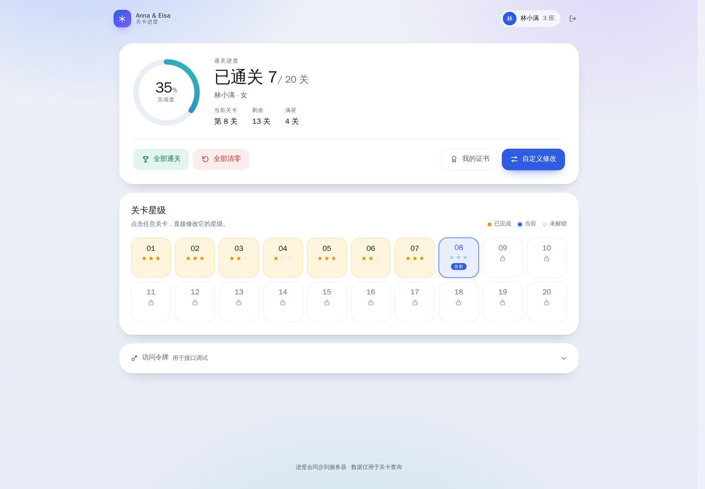
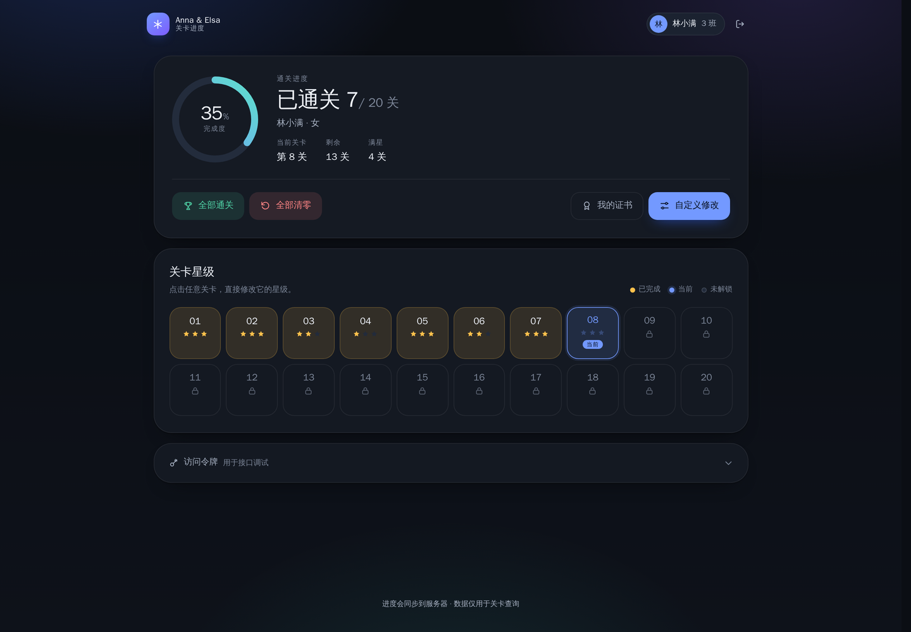
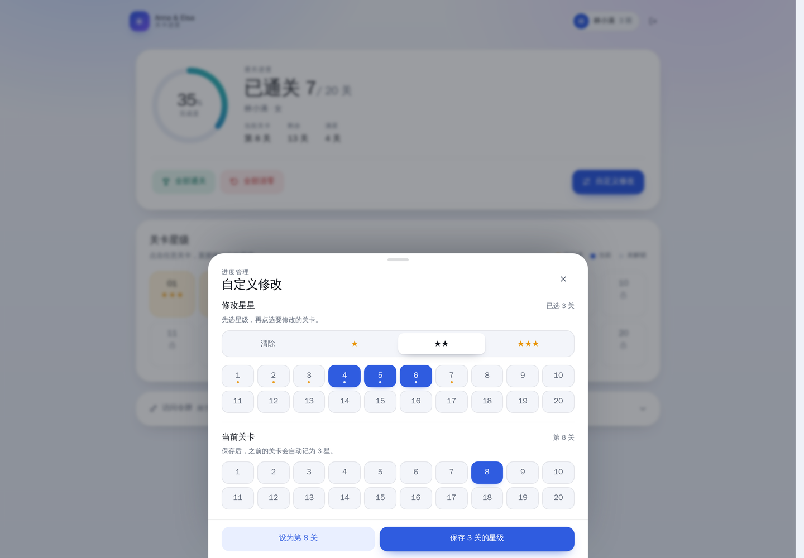
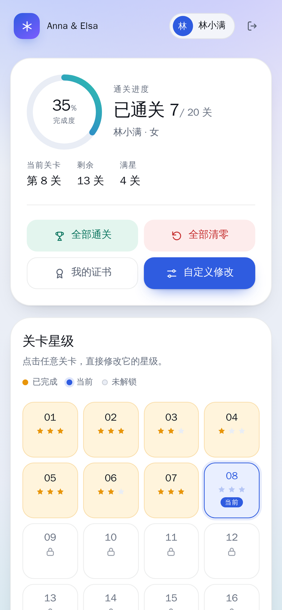
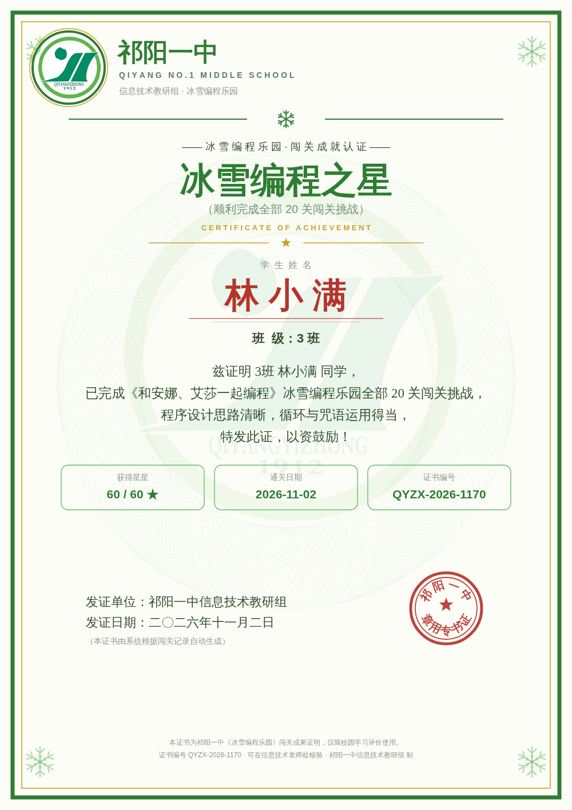
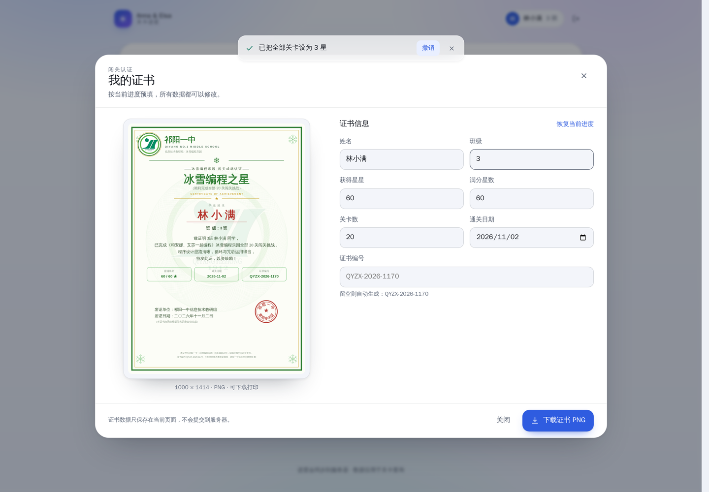

# Anna & Elsa · 关卡进度与闯关证书

《和安娜、艾莎一起编程》冰雪编程乐园的配套工具：登录后查询并修改 20 关的星级与解锁进度，也可以按当前进度生成一张可打印的闯关证书。

官方游戏地址：**http://222.243.213.67:17770**



## 功能

- **进度查询**：姓名 + 密码登录，展示已通关数量、完成度、当前关卡、满星关卡。
- **关卡总览**：20 关星级一览，已完成 / 当前 / 未解锁三种状态，一眼看清。
- **快速修改**
  - 全部通关、全部清零：立即生效，并提供 8 秒内可用的「撤销」。
  - 自定义修改：点任意关卡直接打开面板，可设置当前关卡、批量设置星级。
- **乐观更新**：保存先更新界面，请求失败自动回滚并提示，而不是让人干等转圈。
- **闯关证书**：按当前进度预填，姓名、班级、星星、满分星数、关卡数、通关日期、证书编号均可修改；实时预览，下载 1000 × 1414 的 PNG。
- **Token 查看**：折叠面板中查看并一键复制访问令牌，方便接口调试。
- **细节**：深色模式、响应式布局、键盘操作、读屏标签、`prefers-reduced-motion` / `-transparency` / `-contrast` 适配。

## 界面

| 浅色 | 深色 |
| --- | --- |
|  |  |

| 自定义修改 | 移动端 |
| --- | --- |
|  |  |

## 快速开始

要求 Node.js 20+。

```bash
npm install
npm run dev
```

打开 http://localhost:3000 。默认密码会在登录框中预填，未修改过密码可直接查询。

生产构建：

```bash
npm run build
node .output/server/index.mjs
```

也可以通过 `PORT` 指定端口：

```bash
PORT=8080 node .output/server/index.mjs
```

## 配置

官方 API 地址默认是 `http://222.243.213.67:17770`，可以通过环境变量覆盖（Nuxt runtime config）：

```bash
NUXT_GAME_API_BASE=http://222.243.213.67:17770
```

本地开发时可复制 `.env.example` 为 `.env`。该值只在服务端使用，不会暴露给浏览器。

## 闯关证书

证书渲染器从官方站点的 `js/cert.js` 移植而来，版式、配色、文案与校徽水印均保持一致；校徽取自官方 `js/badge.js`，压缩后放在 `public/school-badge.jpg`。

- 画布尺寸 **1000 × 1414**（A4 竖版比例），PNG 下载。
- 文件名规则：`班级+姓名+冰雪编程世界通关证书.png`，例如 `888班张三冰雪编程世界通关证书.png`。
- 证书编号规则：`QYZX-年份-四位校验码`，校验码由「班级:姓名」哈希得到；把编号留空即自动生成，也可以手动覆盖。
- 可修改数据：姓名、班级、获得星星、满分星数、关卡数、通关日期、证书编号。
- 生成入口：「我的证书」按钮；证书数据只在当前页面使用，**不会提交到服务器**。





> 证书模板、校徽与相关文案来自官方站点，仅用于校园学习评价；版权归原权利人。

## 接口

前端只调用本项目的两个 Nuxt server route，由服务端转发到官方 API：

| 方法 | 路径 | 说明 |
| --- | --- | --- |
| `POST` | `/api/login` | 请求体 `{ name, pwd }`，返回 `{ ok, token, user, progress }` |
| `POST` | `/api/progress` | 请求头 `Authorization: Bearer <token>`，请求体 `{ progress }` |
| `GET` | `/api/health` | 服务端到官方服务器的连通性自检 |

登录与进度接口会**保留官方的状态码和 `msg`**（例如 401 密码错误、429 频率限制），只有网络不可达时才返回 502。这样账号问题不会再被误报成 500。

`progress` 结构：

```json
{
  "unlocked": 8,
  "stars": { "1": 3, "2": 2, "3": 3 }
}
```

`stars` 的键是关卡号（1–20），值是 1–3 星；没有键表示该关未通关。

## 设计说明

- **无 UI 框架**：样式与组件全部手写，主样式在 `app/assets/css/main.css`，使用 CSS 变量同时支持浅色 / 深色。
- **自定义弹簧引擎**：`app/composables/useSpring.js` 用 `response` + `dampingRatio` 描述弹簧，支持从当前值、当前速度重新定向目标，因此动画可以随时被抓住或反向。
- **手势面板**：底部「自定义修改」支持 1:1 拖拽、越界橡皮筋、松手速度接管、动量投影决定关闭或回弹，拖拽过程中遮罩跟随位移。
- **可访问性**：对话框焦点陷阱、Esc / 遮罩关闭、焦点归还、明确的 `aria-label`、键盘可达；axe-core 在浅色 / 深色 / 桌面 / 移动四种组合下均为 0 violations。
- **减少动态**：`prefers-reduced-motion` 下所有弹簧与过渡直接到位；同时支持减少透明度与增强对比度。

## 目录结构

```
app/
  app.vue                 # 页面编排、登录态、进度与 toast
  assets/css/main.css     # 设计系统：颜色、排版、按钮、材质、无障碍偏好
  components/
    LoginCard.vue         # 登录卡片
    ProgressRing.vue      # 弹簧进度环
    LevelGrid.vue         # 20 关星级网格
    CustomSheet.vue       # 可拖拽的自定义修改面板
    CertificateDialog.vue # 证书编辑与实时预览
    ToastHost.vue         # 通知 / 撤销
    UiIcon.vue            # 手写 SVG 图标
  composables/
    useSpring.js          # 弹簧、动量投影、橡皮筋
  utils/
    certificate.js        # 官方证书渲染器（ES module 移植）
server/api/
  login.post.js           # 官方登录 API 代理
  progress.post.js        # 官方进度 API 代理
public/
  school-badge.jpg        # 校徽（来自官方 badge.js）
docs/ui-preview/          # README 预览图
```

## Vercel 部署

部署后打开：

```
https://<你的域名>/api/health
```

正常返回示例：

```json
{ "ok": true, "upstream": "http://222.243.213.67:17770", "status": 200, "ms": 320, "userCount": 42 }
```

- `ok: true, status: 200`：链路正常；登录失败时看接口返回的 `msg`，通常是账号、密码或频率限制。
- `ok: false, status: 0`：Vercel 函数连不上官方服务器。可以在 Vercel 项目设置里把 Function Region 调到离服务器更近的区域（如香港），或使用国内中转。
- 若在 Vercel 设置了 `NUXT_GAME_API_BASE`，请确认使用 `http://`、端口 `17770`，且路径不要以 `/` 结尾。
- 环境变量修改后需要重新部署才会生效。

## 部署提示

- 官方接口是 HTTP，建议在反向代理上启用 HTTPS，避免令牌明文传输。
- 如果 `/api/health` 的 `status` 为 0，说明是 Vercel 出站网络问题，而不是账号问题。
- 登录令牌只保存在当前页面的内存中，刷新后需要重新登录；不存在本地存储或 Cookie。
- 如果官方地址变更，只需设置 `NUXT_GAME_API_BASE`，无需改代码。
- 本工具是官方游戏的配套页面，不是官方游戏本体；进度读写均走官方 API。

## 致谢

- 官方游戏：[和安娜、艾莎一起编程 · 20 关冰雪编程乐园](http://222.243.213.67:17770)
- 证书渲染器与校徽资源来自官方站点的 `js/cert.js`、`js/badge.js`。
- 界面中的图标为手写 SVG，动效基于本项目自带的弹簧实现。
